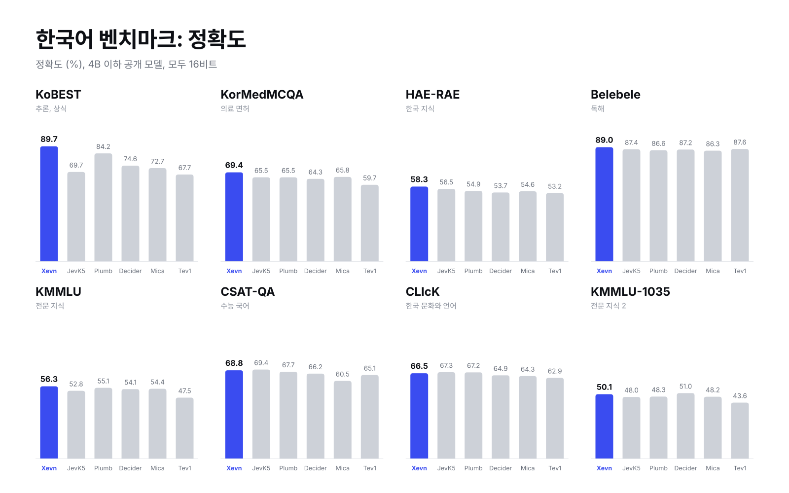
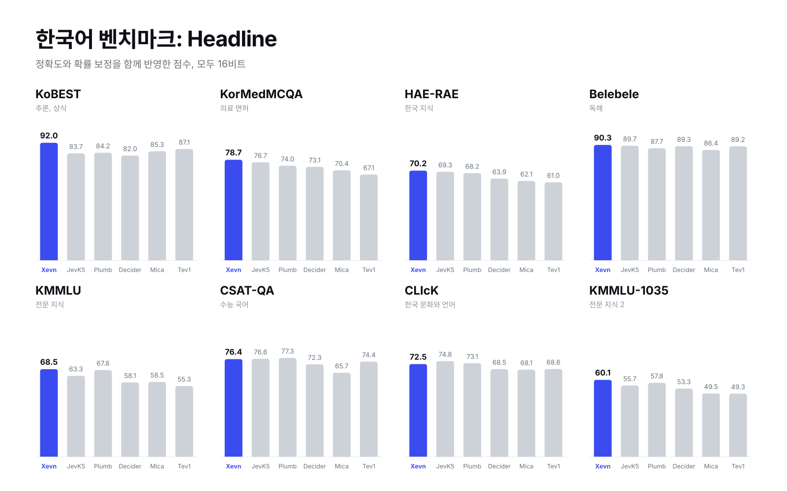
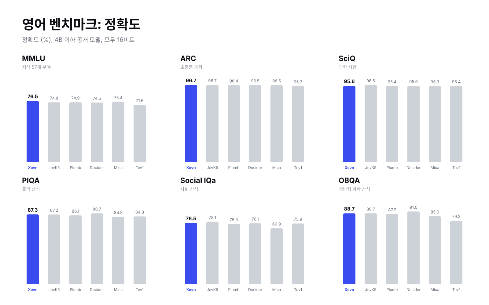
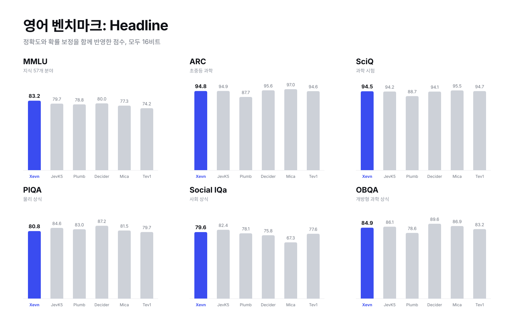
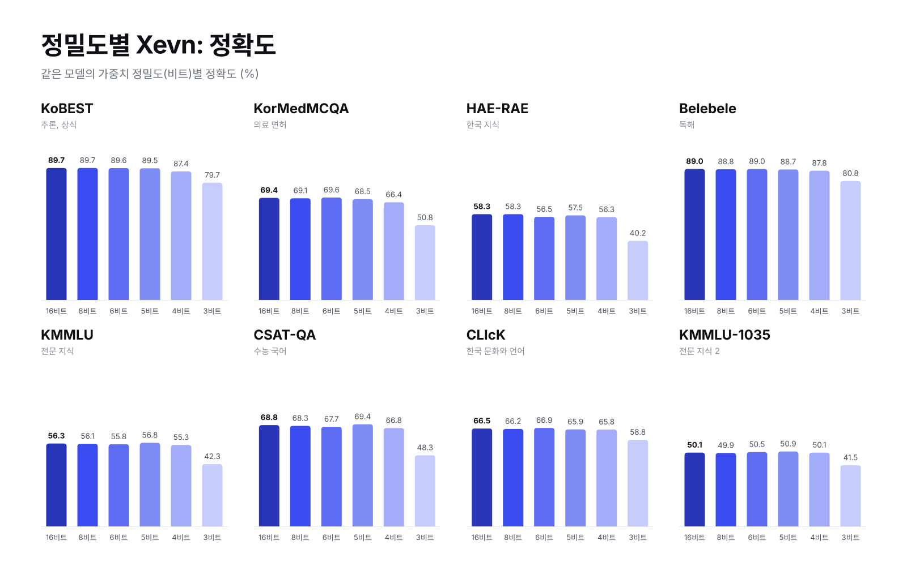

# Xevn

 

[English](README.md) | **한국어**

Xevn은 한국어를 위해 만든 4B 판단 모델입니다. 한국어 이해, 지식, 판단에 맞춰 학습했습니다.

Xevn은 [Jev](https://benchmarkheaven.com/jev-models) 판단 형식을 따릅니다. 질문과 선택지를 한 번 읽고, 답과 함께 모든 선택지의 확률을 돌려줍니다. 문장을 생성하지 않기 때문에 요청 하나에 forward 한 번이면 끝납니다.

## 작업 유형

| 유형 | 입력 | 출력 |
|---|---|---|
| `choice` | 질문과 최대 26개 선택지 | 선택지별 확률 |
| `noul` | 기준이 주어진 예/아니오 질문 | 예일 확률 |
| `score` | 평가 대상과 등급 척도 | 등급별 확률 |

## 벤치마크

### 한국어

**정확도 (%)**

| 벤치마크 | 측정 영역 | **Xevn** | JevK5 | Plumb | Decider | Mica | Tev1 |
|---|---|:-:|:-:|:-:|:-:|:-:|:-:|
| KoBEST | 추론과 상식 | **89.7** | 69.7 | 84.2 | 74.6 | 72.7 | 67.7 |
| KorMedMCQA | 한국 의료 면허 시험 | **69.4** | 65.5 | 65.5 | 64.3 | 65.8 | 59.7 |
| HAE-RAE | 한국 지식 | **58.3** | 56.5 | 54.9 | 53.7 | 54.6 | 53.2 |
| Belebele | 독해 | **89.0** | 87.4 | 86.6 | 87.2 | 86.3 | 87.6 |
| KMMLU | 여러 과목의 전문 지식 | **56.3** | 52.8 | 55.1 | 54.1 | 54.4 | 47.5 |
| CSAT-QA | 수능 국어 | **68.8** | 69.4 | 67.7 | 66.2 | 60.5 | 65.1 |
| CLIcK | 한국 문화와 언어 | **66.5** | 67.3 | 67.2 | 64.9 | 64.3 | 62.9 |
| KMMLU-1035 | 전문 지식 (두 번째 세트) | **50.1** | 48.0 | 48.3 | 51.0 | 48.2 | 43.6 |

**Headline** = (Intelligence + Calibration) / 2. 정확도와 확률 보정을 함께 반영한 JevBench 점수입니다.

| 벤치마크 | **Xevn** | JevK5 | Plumb | Decider | Mica | Tev1 |
|---|:-:|:-:|:-:|:-:|:-:|:-:|
| KoBEST | **92.0** | 83.7 | 84.2 | 82.0 | 85.3 | 87.1 |
| KorMedMCQA | **78.7** | 76.7 | 74.0 | 73.1 | 70.4 | 67.1 |
| HAE-RAE | **70.2** | 69.3 | 68.2 | 63.9 | 62.1 | 61.0 |
| Belebele | **90.3** | 89.7 | 87.7 | 89.3 | 86.4 | 89.2 |
| KMMLU | **68.5** | 63.3 | 67.8 | 58.1 | 58.5 | 55.3 |
| CSAT-QA | **76.4** | 76.6 | 77.3 | 72.3 | 65.7 | 74.4 |
| CLIcK | **72.5** | 74.8 | 73.1 | 68.5 | 68.1 | 68.6 |
| KMMLU-1035 | **60.1** | 55.7 | 57.8 | 53.3 | 49.5 | 49.3 |

### 영어

**정확도 (%)**

| 벤치마크 | 측정 영역 | **Xevn** | JevK5 | Plumb | Decider | Mica | Tev1 |
|---|---|:-:|:-:|:-:|:-:|:-:|:-:|
| MMLU | 57개 분야 지식 | **76.5** | 74.8 | 74.9 | 74.5 | 75.4 | 71.6 |
| ARC | 초중등 과학 | **96.7** | 96.7 | 96.4 | 96.5 | 96.5 | 95.3 |
| SciQ | 과학 시험 문제 | **95.6** | 96.6 | 95.4 | 95.6 | 95.3 | 95.4 |
| PIQA | 물리 상식 | **87.3** | 87.2 | 86.1 | 88.7 | 84.3 | 84.8 |
| Social IQa | 사회 상식 | **76.5** | 78.1 | 75.3 | 76.1 | 69.9 | 75.9 |
| OBQA | 과학 상식 추론 | **88.7** | 88.7 | 87.7 | 91.0 | 85.0 | 79.3 |

**Headline**

| 벤치마크 | **Xevn** | JevK5 | Plumb | Decider | Mica | Tev1 |
|---|:-:|:-:|:-:|:-:|:-:|:-:|
| MMLU | **83.2** | 79.7 | 78.8 | 80.0 | 77.3 | 74.2 |
| ARC | **94.8** | 94.9 | 87.7 | 95.6 | 97.0 | 94.6 |
| SciQ | **94.5** | 94.2 | 88.7 | 94.1 | 95.5 | 94.7 |
| PIQA | **80.8** | 84.6 | 83.0 | 87.2 | 81.5 | 79.7 |
| Social IQa | **79.6** | 82.4 | 78.1 | 75.8 | 67.3 | 77.6 |
| OBQA | **84.9** | 86.1 | 78.6 | 89.6 | 86.9 | 83.2 |

**측정 조건.** 모든 모델을 16비트(bf16, Decider는 공식 FP16)로 실행했고, 같은 프롬프트와 같은 채점 방식을 썼습니다. 하드웨어는 Apple M4 Max입니다.

## 속도

HTTP 단일 요청 지연시간, bf16, Apple M4 Max, 요청 3,000건.

| 입력 길이 | p50 | p95 |
|---|:-:|:-:|
| 64토큰 이하 | 56ms | 64ms |
| 65~128토큰 | 88ms | 103ms |
| 129~256토큰 | 156ms | 188ms |

## 모델

| 정밀도 | 용량 | 속도 (p50) | 다운로드 |
|---|:-:|:-:|:-:|
| 16비트 | 8.4 GB | 88 ms | [MLX](https://huggingface.co/quevirus/Xevn-4B-MLX-bf16) |
| 8비트 | 4.5 GB | 83 ms | [MLX](https://huggingface.co/quevirus/Xevn-4B-MLX-8bit) |
| 6비트 | 3.4 GB | 82 ms | [MLX](https://huggingface.co/quevirus/Xevn-4B-MLX-6bit) |
| 5비트 | 2.9 GB | 80 ms | [MLX](https://huggingface.co/quevirus/Xevn-4B-MLX-5bit) |
| 4비트 | 2.4 GB | 78 ms | [MLX](https://huggingface.co/quevirus/Xevn-4B-MLX-4bit) |
| 3비트 | 1.8 GB | 77 ms | [MLX](https://huggingface.co/quevirus/Xevn-4B-MLX-3bit) |
| GGUF BF16 | 8.7 GB |  | [GGUF](https://huggingface.co/quevirus/Xevn-4B-GGUF/blob/main/Xevn-4B-BF16.gguf) |
| GGUF Q8_0 | 4.6 GB |  | [GGUF](https://huggingface.co/quevirus/Xevn-4B-GGUF/blob/main/Xevn-4B-Q8_0.gguf) |
| GGUF Q6_K | 3.6 GB |  | [GGUF](https://huggingface.co/quevirus/Xevn-4B-GGUF/blob/main/Xevn-4B-Q6_K.gguf) |
| GGUF Q5_K_M | 3.2 GB |  | [GGUF](https://huggingface.co/quevirus/Xevn-4B-GGUF/blob/main/Xevn-4B-Q5_K_M.gguf) |
| GGUF Q4_K_M | 2.8 GB |  | [GGUF](https://huggingface.co/quevirus/Xevn-4B-GGUF/blob/main/Xevn-4B-Q4_K_M.gguf) |

16비트는 bf16 형식입니다. 속도는 세 입력 길이를 같은 비율로 섞은 p50이며, 속도 표와 같은 세션에서 측정했습니다. 모든 벤치마크에서 8비트부터 5비트까지는 16비트 대비 정확도 2점 이내, 4비트는 3점 이내입니다. 3비트는 7~21점 떨어지며 실험용으로 제공합니다.

PyTorch (Transformers) 16비트 가중치: [Xevn-4B](https://huggingface.co/quevirus/Xevn-4B).

### 벤치마크별 정밀도 비교

**정확도 (%)**

| 벤치마크 | 16비트 | 8비트 | 6비트 | 5비트 | 4비트 | 3비트 |
|---|:-:|:-:|:-:|:-:|:-:|:-:|
| KoBEST | 89.7 | 89.7 | 89.6 | 89.5 | 87.4 | 79.7 |
| KorMedMCQA | 69.4 | 69.1 | 69.6 | 68.5 | 66.4 | 50.8 |
| HAE-RAE | 58.3 | 58.3 | 56.5 | 57.5 | 56.3 | 40.2 |
| Belebele | 89.0 | 88.8 | 89.0 | 88.7 | 87.8 | 80.8 |
| KMMLU | 56.3 | 56.1 | 55.8 | 56.8 | 55.3 | 42.3 |
| CSAT-QA | 68.8 | 68.3 | 67.7 | 69.4 | 66.8 | 48.3 |
| CLIcK | 66.5 | 66.2 | 66.9 | 65.9 | 65.8 | 58.8 |
| KMMLU-1035 | 50.1 | 49.9 | 50.5 | 50.9 | 50.1 | 41.5 |

**Headline**

| 벤치마크 | 16비트 | 8비트 | 6비트 | 5비트 | 4비트 | 3비트 |
|---|:-:|:-:|:-:|:-:|:-:|:-:|
| KoBEST | 92.0 | 91.9 | 92.4 | 91.4 | 90.8 | 80.6 |
| KorMedMCQA | 78.7 | 78.7 | 79.0 | 77.8 | 75.5 | 65.9 |
| HAE-RAE | 70.2 | 69.9 | 68.9 | 68.2 | 68.1 | 56.9 |
| Belebele | 90.3 | 90.0 | 89.6 | 89.2 | 89.6 | 82.8 |
| KMMLU | 68.5 | 68.7 | 68.1 | 69.7 | 69.1 | 55.8 |
| CSAT-QA | 76.4 | 76.4 | 74.7 | 74.5 | 74.5 | 61.8 |
| CLIcK | 72.5 | 72.2 | 72.6 | 73.1 | 74.5 | 68.0 |
| KMMLU-1035 | 60.1 | 59.9 | 60.8 | 61.3 | 61.1 | 53.4 |

## 용도

Xevn은 판단을 위한 모델입니다: 분류, 객관식, 예/아니오 판정, 등급 평가. 대화나 문장 생성 모델이 아닙니다. 한국어에 맞춰 학습했으며, 영어 입력도 동작하지만 주력은 아닙니다.

## 라이선스

[Apache 2.0](LICENSE). [Qwen3.5-4B](https://huggingface.co/Qwen/Qwen3.5-4B) 기반.
