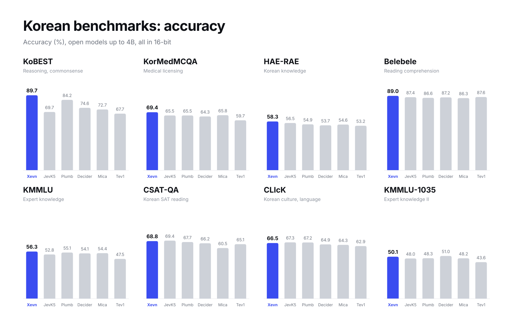
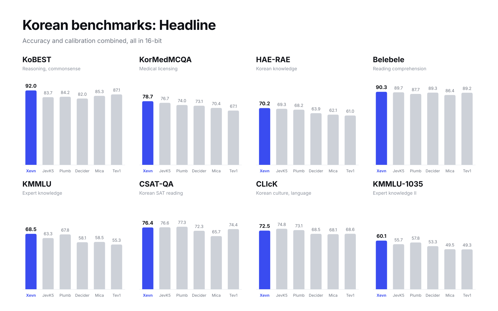
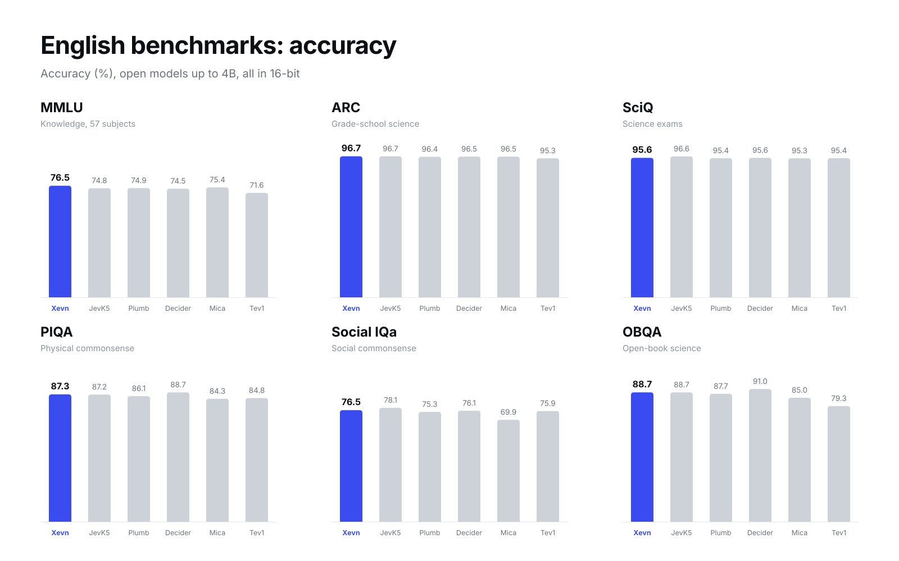
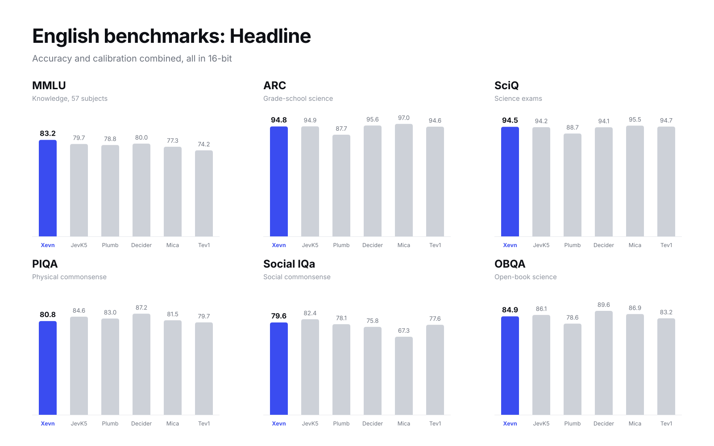
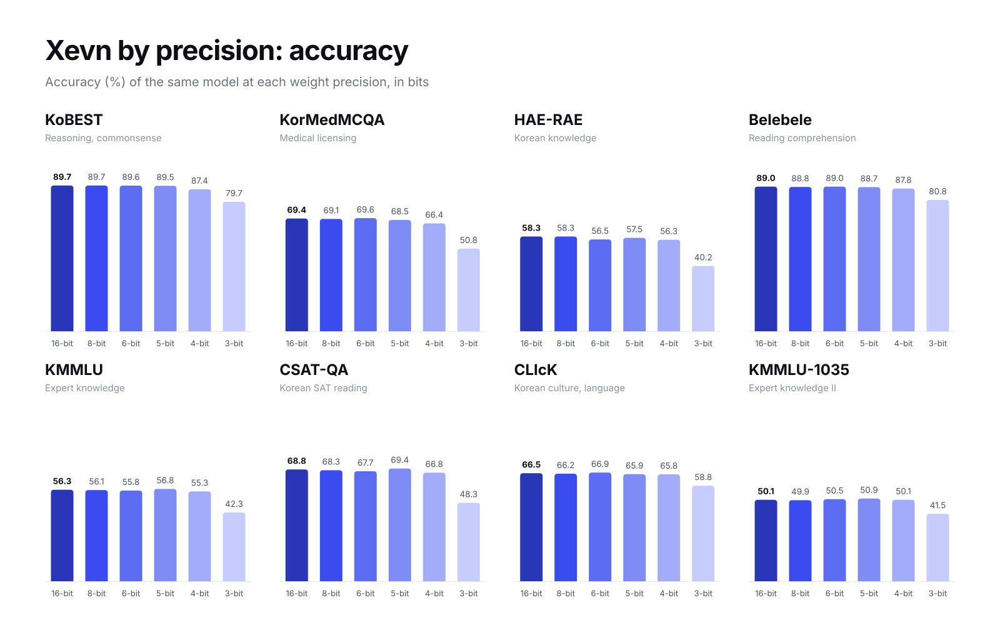

# Xevn

 

**English** | [한국어](README.ko.md)

Xevn is a 4B decision model built for Korean, trained for Korean understanding, knowledge, and judgment.

Xevn follows the [Jev](https://benchmarkheaven.com/jev-models) decision format. It reads a question and its options once and returns the answer together with a probability for every option. There is no text generation, so a request costs one forward pass.

## Tasks

| Type | Input | Output |
|---|---|---|
| `choice` | A question and up to 26 options | Probability for each option |
| `noul` | A yes/no question with criteria | Probability of yes |
| `score` | An item and a graded scale | Probability for each level |

## Benchmarks

### Korean

**Accuracy (%)**

| Benchmark | Measures | **Xevn** | JevK5 | Plumb | Decider | Mica | Tev1 |
|---|---|:-:|:-:|:-:|:-:|:-:|:-:|
| KoBEST | Reasoning and commonsense | **89.7** | 69.7 | 84.2 | 74.6 | 72.7 | 67.7 |
| KorMedMCQA | Korean medical licensing exams | **69.4** | 65.5 | 65.5 | 64.3 | 65.8 | 59.7 |
| HAE-RAE | Korean knowledge | **58.3** | 56.5 | 54.9 | 53.7 | 54.6 | 53.2 |
| Belebele | Reading comprehension | **89.0** | 87.4 | 86.6 | 87.2 | 86.3 | 87.6 |
| KMMLU | Expert knowledge across subjects | **56.3** | 52.8 | 55.1 | 54.1 | 54.4 | 47.5 |
| CSAT-QA | Korean SAT reading | **68.8** | 69.4 | 67.7 | 66.2 | 60.5 | 65.1 |
| CLIcK | Korean culture and language | **66.5** | 67.3 | 67.2 | 64.9 | 64.3 | 62.9 |
| KMMLU-1035 | Expert knowledge, second set | **50.1** | 48.0 | 48.3 | 51.0 | 48.2 | 43.6 |

**Headline** = (Intelligence + Calibration) / 2, the JevBench score that combines accuracy and calibration.

| Benchmark | **Xevn** | JevK5 | Plumb | Decider | Mica | Tev1 |
|---|:-:|:-:|:-:|:-:|:-:|:-:|
| KoBEST | **92.0** | 83.7 | 84.2 | 82.0 | 85.3 | 87.1 |
| KorMedMCQA | **78.7** | 76.7 | 74.0 | 73.1 | 70.4 | 67.1 |
| HAE-RAE | **70.2** | 69.3 | 68.2 | 63.9 | 62.1 | 61.0 |
| Belebele | **90.3** | 89.7 | 87.7 | 89.3 | 86.4 | 89.2 |
| KMMLU | **68.5** | 63.3 | 67.8 | 58.1 | 58.5 | 55.3 |
| CSAT-QA | **76.4** | 76.6 | 77.3 | 72.3 | 65.7 | 74.4 |
| CLIcK | **72.5** | 74.8 | 73.1 | 68.5 | 68.1 | 68.6 |
| KMMLU-1035 | **60.1** | 55.7 | 57.8 | 53.3 | 49.5 | 49.3 |

### English

**Accuracy (%)**

| Benchmark | Measures | **Xevn** | JevK5 | Plumb | Decider | Mica | Tev1 |
|---|---|:-:|:-:|:-:|:-:|:-:|:-:|
| MMLU | Knowledge across 57 subjects | **76.5** | 74.8 | 74.9 | 74.5 | 75.4 | 71.6 |
| ARC | Grade-school science | **96.7** | 96.7 | 96.4 | 96.5 | 96.5 | 95.3 |
| SciQ | Science exam questions | **95.6** | 96.6 | 95.4 | 95.6 | 95.3 | 95.4 |
| PIQA | Physical commonsense | **87.3** | 87.2 | 86.1 | 88.7 | 84.3 | 84.8 |
| Social IQa | Social commonsense | **76.5** | 78.1 | 75.3 | 76.1 | 69.9 | 75.9 |
| OBQA | Open-book science reasoning | **88.7** | 88.7 | 87.7 | 91.0 | 85.0 | 79.3 |

**Headline**

| Benchmark | **Xevn** | JevK5 | Plumb | Decider | Mica | Tev1 |
|---|:-:|:-:|:-:|:-:|:-:|:-:|
| MMLU | **83.2** | 79.7 | 78.8 | 80.0 | 77.3 | 74.2 |
| ARC | **94.8** | 94.9 | 87.7 | 95.6 | 97.0 | 94.6 |
| SciQ | **94.5** | 94.2 | 88.7 | 94.1 | 95.5 | 94.7 |
| PIQA | **80.8** | 84.6 | 83.0 | 87.2 | 81.5 | 79.7 |
| Social IQa | **79.6** | 82.4 | 78.1 | 75.8 | 67.3 | 77.6 |
| OBQA | **84.9** | 86.1 | 78.6 | 89.6 | 86.9 | 83.2 |

**Setup.** Every model was run in 16-bit (bf16; Decider in its official FP16) with the same prompts and the same scoring, on an Apple M4 Max.

## Speed

Latency of a single request over HTTP, bf16, Apple M4 Max, 3,000 requests.

| Input length | p50 | p95 |
|---|:-:|:-:|
| up to 64 tokens | 56 ms | 64 ms |
| 65 to 128 tokens | 88 ms | 103 ms |
| 129 to 256 tokens | 156 ms | 188 ms |

## Models

| Precision | Size | Speed (p50) | Download |
|---|:-:|:-:|:-:|
| 16-bit | 8.4 GB | 88 ms | [MLX](https://huggingface.co/quevirus/Xevn-4B-MLX-bf16) |
| 8-bit | 4.5 GB | 83 ms | [MLX](https://huggingface.co/quevirus/Xevn-4B-MLX-8bit) |
| 6-bit | 3.4 GB | 82 ms | [MLX](https://huggingface.co/quevirus/Xevn-4B-MLX-6bit) |
| 5-bit | 2.9 GB | 80 ms | [MLX](https://huggingface.co/quevirus/Xevn-4B-MLX-5bit) |
| 4-bit | 2.4 GB | 78 ms | [MLX](https://huggingface.co/quevirus/Xevn-4B-MLX-4bit) |
| 3-bit | 1.8 GB | 77 ms | [MLX](https://huggingface.co/quevirus/Xevn-4B-MLX-3bit) |
| GGUF BF16 | 8.7 GB |  | [GGUF](https://huggingface.co/quevirus/Xevn-4B-GGUF/blob/main/Xevn-4B-BF16.gguf) |
| GGUF Q8_0 | 4.6 GB |  | [GGUF](https://huggingface.co/quevirus/Xevn-4B-GGUF/blob/main/Xevn-4B-Q8_0.gguf) |
| GGUF Q6_K | 3.6 GB |  | [GGUF](https://huggingface.co/quevirus/Xevn-4B-GGUF/blob/main/Xevn-4B-Q6_K.gguf) |
| GGUF Q5_K_M | 3.2 GB |  | [GGUF](https://huggingface.co/quevirus/Xevn-4B-GGUF/blob/main/Xevn-4B-Q5_K_M.gguf) |
| GGUF Q4_K_M | 2.8 GB |  | [GGUF](https://huggingface.co/quevirus/Xevn-4B-GGUF/blob/main/Xevn-4B-Q4_K_M.gguf) |

16-bit is the bf16 format. Speed is the p50 over an equal mix of the three input lengths, measured in the same session as the Speed table. On every benchmark, 8-bit to 5-bit stay within 2 points of 16-bit accuracy and 4-bit within 3 points. 3-bit loses 7 to 21 points and is provided for experimentation.

PyTorch (Transformers) 16-bit weights: [Xevn-4B](https://huggingface.co/quevirus/Xevn-4B).

### By benchmark

**Accuracy (%)**

| Benchmark | 16-bit | 8-bit | 6-bit | 5-bit | 4-bit | 3-bit |
|---|:-:|:-:|:-:|:-:|:-:|:-:|
| KoBEST | 89.7 | 89.7 | 89.6 | 89.5 | 87.4 | 79.7 |
| KorMedMCQA | 69.4 | 69.1 | 69.6 | 68.5 | 66.4 | 50.8 |
| HAE-RAE | 58.3 | 58.3 | 56.5 | 57.5 | 56.3 | 40.2 |
| Belebele | 89.0 | 88.8 | 89.0 | 88.7 | 87.8 | 80.8 |
| KMMLU | 56.3 | 56.1 | 55.8 | 56.8 | 55.3 | 42.3 |
| CSAT-QA | 68.8 | 68.3 | 67.7 | 69.4 | 66.8 | 48.3 |
| CLIcK | 66.5 | 66.2 | 66.9 | 65.9 | 65.8 | 58.8 |
| KMMLU-1035 | 50.1 | 49.9 | 50.5 | 50.9 | 50.1 | 41.5 |

**Headline**

| Benchmark | 16-bit | 8-bit | 6-bit | 5-bit | 4-bit | 3-bit |
|---|:-:|:-:|:-:|:-:|:-:|:-:|
| KoBEST | 92.0 | 91.9 | 92.4 | 91.4 | 90.8 | 80.6 |
| KorMedMCQA | 78.7 | 78.7 | 79.0 | 77.8 | 75.5 | 65.9 |
| HAE-RAE | 70.2 | 69.9 | 68.9 | 68.2 | 68.1 | 56.9 |
| Belebele | 90.3 | 90.0 | 89.6 | 89.2 | 89.6 | 82.8 |
| KMMLU | 68.5 | 68.7 | 68.1 | 69.7 | 69.1 | 55.8 |
| CSAT-QA | 76.4 | 76.4 | 74.7 | 74.5 | 74.5 | 61.8 |
| CLIcK | 72.5 | 72.2 | 72.6 | 73.1 | 74.5 | 68.0 |
| KMMLU-1035 | 60.1 | 59.9 | 60.8 | 61.3 | 61.1 | 53.4 |

## Intended use

Xevn is built for decisions: classification, multiple choice, yes/no judgments, and rating. It is not a chat or text-generation model. It is tuned for Korean; English input works but is not the focus.

## License

[Apache 2.0](LICENSE). Built on [Qwen3.5-4B](https://huggingface.co/Qwen/Qwen3.5-4B).
